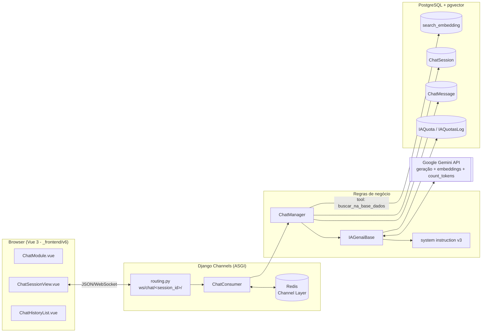
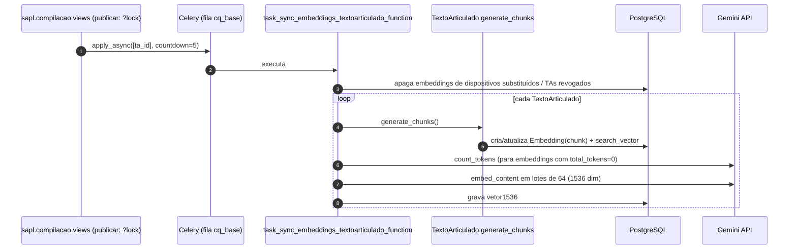
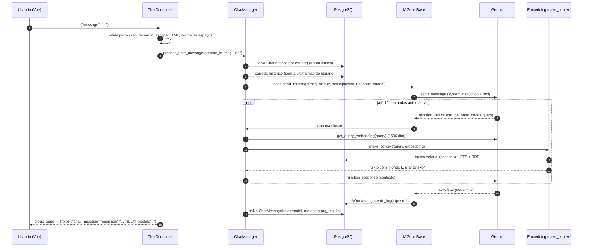

# 1. Arquitetura do Chat RAG

## 1.1 Visão geral

O sistema tem **duas fases independentes**, ligadas apenas pela tabela `search_embedding`:

1. **Indexação (offline, assíncrona)** – disparada quando um Texto Articulado é *publicado*.
   Transforma dispositivos legais em *chunks* de texto, calcula tokens, `tsvector` e vetor semântico.
2. **Consulta (online, interativa)** – o usuário conversa via WebSocket; o LLM decide **quando e o que
   buscar** chamando uma *tool* (`buscar_na_base_dados`), que executa a recuperação híbrida e devolve
   o contexto que fundamenta a resposta.

> Diferente de um RAG "clássico" em que o backend sempre injeta o contexto no prompt, aqui o RAG é
> **agêntico**: o contexto só entra se o modelo chamar a função (até 10 chamadas automáticas por
> mensagem). A *system instruction* obriga o modelo a sempre usar a ferramenta.

## 1.2 Diagrama de componentes

## 1.3 Fluxo de indexação (publicação de Texto Articulado)

## 1.4 Fluxo de uma pergunta (online)

## 1.5 Mapa de responsabilidades

| Camada | Classe / função | Responsabilidade |
|--------|-----------------|------------------|
| Transporte | `ChatConsumer` | Autenticação/permissão, conexão única por sessão, validação e normalização da entrada, envio de respostas e erros |
| Aplicação | `ChatManager` | Limites (sessões/dia, mensagens/sessão), persistência de mensagens, título da sessão, histórico no formato Gemini, definição da *tool* de busca |
| Integração I.A. | `IAGenaiBase` | Cliente Gemini, configuração de geração, seleção de cota/modelo, `chats.create`, embeddings, contagem de tokens |
| Recuperação | `Embedding.make_context` | Busca híbrida (vetorial + FTS), fusão RRF, agrupamento por Texto Articulado, deduplicação e links de fonte |
| Indexação | `TextoArticulado.generate_chunks` + task Celery | Segmentação hierárquica dos dispositivos, persistência de chunks, embeddings |
| Persistência | `Embedding`, `ChatSession`, `ChatMessage`, `IAQuota` | Dados vetoriais, conversas e controle de consumo |
| Apresentação | `ChatSessionView.vue` | WebSocket, renderização das mensagens, tratamento do código `4001` |

## 1.6 Decisões de projeto relevantes

| Decisão | Motivo / efeito |
|---------|-----------------|
| **Chunk por dispositivo com hierarquia** (ancestrais + descendentes) | Cada chunk carrega o "caminho" jurídico (ex.: Lei › Capítulo › Artigo › Parágrafo), preservando contexto para o LLM |
| **Busca híbrida (semântica + FTS) com RRF** | Semântica captura sinônimos; FTS captura números de lei e termos exatos (ex.: "4353"); RRF combina rankings sem calibrar escalas |
| **`halfvec(1536)` + HNSW cosseno** | Metade da memória/índice de `vector(3072)`, com boa qualidade; Gemini permite reduzir dimensões na API |
| **Contexto agrupado por Texto Articulado e ordenado por `ordem`** | O LLM lê a norma em ordem natural, e não em ordem de similaridade aleatória |
| **Deduplicação de prefixos comuns** | Chunks vizinhos repetem ancestrais; a fusão evita repetir o mesmo cabeçalho e economiza tokens |
| **Links relativos `/ta/<id>/text`** | A resposta cita a fonte com link interno clicável; links externos são proibidos pela *system instruction* |
| **Cotas diárias por modelo (`IAQuota`)** | Controle de custo e rotação de modelos disponíveis |
| **Uma conexão ativa por sessão (código 4001)** | Evita respostas duplicadas e corridas na mesma conversa |

## 1.7 Dependências externas

* **PostgreSQL** com extensão `vector` (pgvector) e dicionário de FTS `portuguese`.
* **Redis**: broker do Celery e *channel layer* do Channels (`CHANNEL_LAYERS`).
* **Google Gemini API** (`google-genai`): geração, embeddings, `count_tokens`, listagem de modelos.
* **PyMuPDF** (`pymupdf`): usado em `_extract_pdf_text` (OCR de PDFs – fora do fluxo do chat, mas parte de `IAGenaiBase`).
* **BeautifulSoup** (`bs`): normalização de entidades HTML nos chunks.
