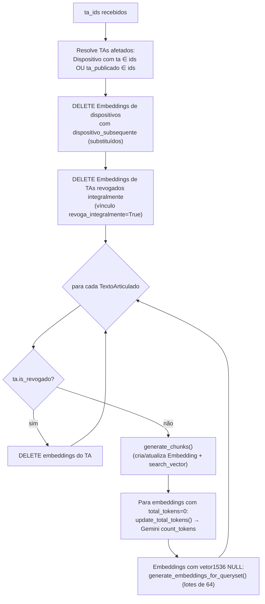
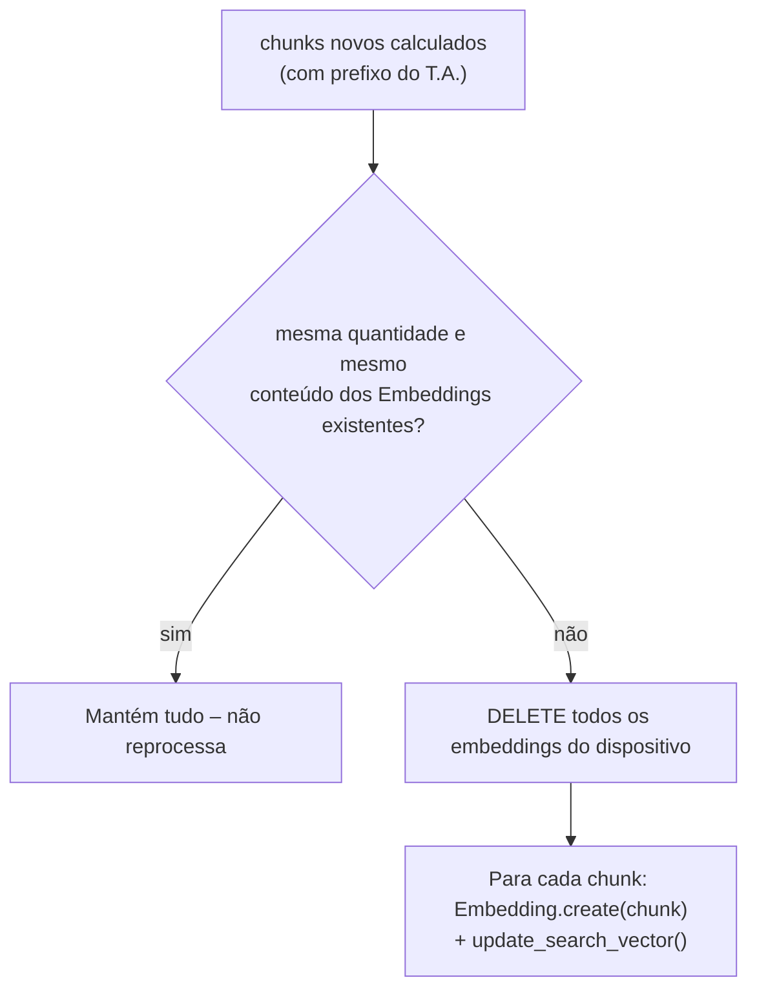

# 2. Ingestão e Indexação (pipeline offline)

Responsável por popular `search_embedding` com os trechos pesquisáveis das normas.

Arquivos envolvidos:

* Gatilho: [sapl/compilacao/views.py](../../sapl/compilacao/views.py) (publicação do T.A.)
* Orquestração: [cmj/search/tasks.py](../../cmj/search/tasks.py)
* Segmentação: `TextoArticulado.generate_chunks` em [sapl/compilacao/models.py](../../sapl/compilacao/models.py)
* Persistência/vetorização: `Embedding` em [cmj/search/models.py](../../cmj/search/models.py)
* API de embeddings: `IAGenaiBase.embed_documents` em [cmj/utils/genia/\_\_init\_\_.py](../../cmj/utils/genia/__init__.py)

## 2.1 Gatilho

Ao publicar um Texto Articulado (parâmetro `lock` na view de checagem/publicação), o T.A. é marcado
como `editing_locked=True` e público, e então:

| Ambiente | Execução |
|----------|----------|
| Produção (`not DEBUG`) ou DEBUG dentro do container oficial (`FOLDER_DEBUG_CONTAINER == PROJECT_DIR`) | `task_sync_embeddings_textoarticulado.apply_async(([ta_id],), countdown=5)` na fila Celery **`cq_base`** |
| DEBUG local | Chamada síncrona de `task_sync_embeddings_textoarticulado_function([ta_id])` |

A task captura qualquer exceção e apenas registra em log (`logger.error`) – falhas não interrompem a publicação.

## 2.2 Orquestração – `task_sync_embeddings_textoarticulado_function(ta_ids)`



Pontos importantes:

* O escopo considera tanto `ta` quanto `ta_publicado` – assim, um T.A. de **alteração** que modifica
  dispositivos de outra norma faz a norma alterada ser **reindexada**.
* Só entram no índice dispositivos **vigentes** (`dispositivo_subsequente IS NULL`). Quando um dispositivo
  é substituído por uma redação nova, seus embeddings antigos são apagados.
* Normas **revogadas integralmente** não ficam no índice (o chat não responde com lei revogada).
* A contagem de tokens é informativa: uma falha em `count_tokens` (retorna 0) **não** impede a vetorização.

## 2.3 Segmentação v1 – `TextoArticulado.generate_chunks()`

> Esta é a estratégia **v1** (janela por dispositivo), ainda a padrão. A estratégia **v2** (por artigo), mais
> eficiente na avaliação, está descrita em [§2.6](#26-chunking-v2-por-artigo).

### Quais dispositivos geram chunks

Somente os tipos **individualizáveis** (constante `CHUNK_TIPOS_INDIVIDUALIZAVEIS` em
[sapl/compilacao/models.py](../../sapl/compilacao/models.py)):

```python
["Ementa", "Artigo", "Parágrafo", "Inciso", "Alinea", "Item",
 "Inciso de Item", "Alinea de Item", "Anexo", "Texto Não Estruturado"]
```

Dispositivos de outros tipos (Capítulo, Seção, Título, Livro etc.) **não geram chunk próprio**, mas
aparecem como *ancestrais* no cabeçalho dos chunks de seus filhos. Dispositivos sem texto **e** sem
rótulo são ignorados.

> No modelo de dados o **Artigo tem `texto` vazio**: o caput é um filho do tipo `Caput`, que não é
> individualizável e entra no chunk do Artigo (como descendente) e nos de seus incisos (como ancestral).

Regras específicas dos tipos de conteúdo "solto":

| Tipo | Regra |
|------|-------|
| **Anexo** | Gera chunk com o rótulo + título + descendentes (inclui os "Texto Não Estruturado" filhos). Anexo com menos de `CHUNK_ANEXO_MIN_PALAVRAS` (8) palavras além do rótulo (ex.: só imagem) é ignorado |
| **Texto Não Estruturado** | O HTML é convertido em texto puro (`texto_plano_html`) antes de ser embutido. Só é individualizado se for **filho da Articulação** (os filhos de `Caput`/`Anexo` já estão no chunk do pai) e tiver ao menos `CHUNK_TNU_MIN_PALAVRAS` (40) palavras – abaixo disso são, em geral, fechos e assinaturas ("Prefeito Municipal…") sem conteúdo normativo |

### Composição do texto de cada chunk

Para um dispositivo `d` individualizável, o texto é `ancestrais + [d] + seguintes`:

| Parte | Como é obtida |
|-------|---------------|
| **Ancestrais** (`textos_previous`) | `d.get_parents()` – inseridos do mais alto ao mais próximo, cada um como `"<rótulo> <texto renderizado>"` |
| **O próprio dispositivo** | `rótulo + " " + render_texto()` |
| **Seguintes** (`textos_next`) | Os dispositivos subsequentes na ordem do T.A., enquanto `nivel > d.nivel` (descendentes). O primeiro dispositivo de nível **≤** ao de `d` (fronteira) **também é incluído**; se essa fronteira for um **Artigo**, inclui-se **mais um** dispositivo depois dele |

```text
Exemplo (Art. 5º com 2 incisos, seguido do Art. 6º):

  [ancestrais]   CAPÍTULO II - DOS INCENTIVOS
  [d]            Art. 5º  A prefeitura poderá conceder ...:
  [descendente]  I - asfaltamento ...
  [descendente]  II - terraplenagem ...
  [fronteira]    Art. 6º  ...
  [+1 extra]     (dispositivo seguinte ao Art. 6º, pois a fronteira é Artigo)
```

O objetivo é que a resposta nunca fique "cortada": o LLM vê o *caput*, os incisos/alíneas e o começo do
próximo artigo.

Chunks vazios (sem conteúdo) nunca são gerados.

### Divisão por tamanho (`chunk_size = 1536` **palavras**)

Os textos são acumulados em `current_chunk` separados por `" \n "`. Se adicionar o próximo texto ultrapassar
**1536 palavras** (contadas com `split()`, não tokens), fecha-se o chunk atual e inicia-se outro.

### Normalização

Para cada chunk:

1. `str(BeautifulSoup(c, "html.parser"))` – converte entidades (`&aacute;` → `á`);
2. `re.sub(r"[ \t]{2,}", " ")` – colapsa espaços/tabs;
3. `re.sub(r" \n \n ", " \n ")` – remove linhas vazias duplicadas;
4. remove espaços/quebras de linha iniciais.

### Formato final persistido

```text
<str(TextoArticulado)> \n <chunk normalizado>
```

A **primeira linha** é sempre a identificação do Texto Articulado (ex.: "Lei Ordinária 4.353/2020 …").
É ela que a recuperação transforma em `Fonte: <a href="/ta/<id>/text">…</a>`
(ver [03-recuperacao-hibrida.md](./03-recuperacao-hibrida.md)).

### Sincronização incremental com o banco

Para cada dispositivo com chunks:



Consequência: **vetores só são recalculados quando o texto muda**, economizando chamadas à API.
Novos embeddings nascem com `total_tokens=0` e `vetor1536=NULL`, o que os marca como pendentes para
as etapas seguintes da task.

O método retorna a lista `[(dispositivo, {"embeddings","rendered","texto","rotulo","chunks"}), ...]`,
que a task usa para filtrar os embeddings do T.A. corrente.

## 2.4 Vetorização e tokens (`Embedding`)

| Método | O que faz |
|--------|-----------|
| `update_search_vector()` | `UPDATE ... SET search_vector = to_tsvector('portuguese', chunk)` para a linha |
| `update_all_search_vectors()` (classmethod) | Mesmo `UPDATE` em lote para toda a tabela (útil em reindexação total) |
| `update_total_tokens()` | `IAGenaiBase.count_tokens_in_text(chunk)` (Gemini `count_tokens`, 0 em caso de erro) e `save()` |
| `generate_embedding()` | Vetoriza **um** chunk, salva em `vetor1536` |
| `generate_embeddings_for_queryset(qs, slice_size=256)` | Vetoriza o queryset **em fatias**, gravando o progresso a cada fatia (`vetor1536`; zera o campo legado `vetor`). Embeddings que falharem continuam sem vetor (pendentes). Retorna a quantidade vetorizada |

### `IAGenaiBase.embed_documents`

* Modelo: **`gemini-embedding-2`**, `output_dimensionality=1536`.
* Lotes de **64** documentos por chamada.
* Formatação de documento exigida pelo modelo: `"title: {titulo|none} | text: {texto}"`
  (`prepare_document`). Aqui o título é sempre `None` → `title: none | text: ...`.
* `task_type` **não** é enviado (a instrução vai no próprio texto).
* **Resiliência** (antes, o primeiro erro abortava tudo e descartava o restante):
  1. cada lote é tentado até `EMBED_MAX_ATTEMPTS` (3) vezes, com espera exponencial
     (`EMBED_RETRY_BASE_DELAY` = 2 s → 2, 4 s);
  2. se o lote continua falhando, seus documentos são reenviados **um a um**, para que um chunk
     problemático (ex.: texto acima do limite do modelo) não derrube os outros 63;
  3. o retorno é uma lista **alinhada** a `documents`, com `None` nos que falharam;
  4. se `EMBED_MAX_CONSECUTIVE_FAILED_BATCHES` (2) lotes seguidos falharem por completo (API fora do ar,
     cota), a execução é interrompida e a lista parcial é devolvida.

### Assimetria documento × consulta

| Lado | Formato do texto enviado ao modelo |
|------|------------------------------------|
| Documento | `title: none \| text: <chunk>` |
| Consulta | `task: question answering \| query: <consulta>` (`get_query_embedding`, `is_qa_mode=True`) |

Essa assimetria é intencional e recomendada para o `gemini-embedding-2`. Se o formato de documento
mudar, **todos os vetores precisam ser regenerados** para manter a comparabilidade.

## 2.5 Reindexação e completude do índice (`sync_embeddings`)

O comando [sync_embeddings](../../cmj/search/management/commands/sync_embeddings.py) completa o índice
sem depender de uma nova publicação. Ele reindexa (chunks) os T.A. selecionados e, ao final, vetoriza
**todos** os embeddings pendentes (`vetor1536` nulo) e preenche `search_vector` ausentes.

```bash
# Quanto falta (nada é gravado)
python manage.py sync_embeddings --tipos Anexo "Texto Não Estruturado" --sem-embedding --dry-run

# Indexar os tipos novos nos T.A. publicados e as normas sem nenhum embedding, e vetorizar os pendentes
python manage.py sync_embeddings --tipos Anexo "Texto Não Estruturado" --sem-embedding

# Somente vetorizar os pendentes
python manage.py sync_embeddings

# Reindexar T.A. específicos, sem vetorizar pendentes
python manage.py sync_embeddings --ta-ids 793 1021 --sem-pendentes
```

Só T.A. **publicados** (`editing_locked=True`) são selecionados por `--tipos` e `--sem-embedding`, para
não indexar rascunhos. O comando é **retomável**: o que falhar continua pendente e uma nova execução
continua de onde parou. A vetorização consome a API do Gemini (cota/custo).

Outros cenários (alterar modelo de embedding, formato do prefixo ou algoritmo de chunking):

1. Ajustar o código (ex.: `chunk_size`, tipos individualizáveis).
2. Executar `sync_embeddings --ta-ids ...` ou `task_sync_embeddings_textoarticulado_function([ids...])`
   (ver `__notebooks_private/2026/compilacao__dispositivo__chunking.py` para experimentos).
3. Para forçar novos vetores: `Embedding.objects.update(vetor1536=None)` e executar `sync_embeddings`
   (os registros voltam a ser "pendentes").
4. Para recalcular o FTS em massa: `Embedding.update_all_search_vectors()`.

## 2.6 Chunking v2 (por artigo)

Código: [sapl/compilacao/chunking.py](../../sapl/compilacao/chunking.py) (lógica **pura**, sem banco, testada em
[test_chunking.py](../../sapl/compilacao/test_chunking.py)) e `TextoArticulado.generate_chunks_v2()` (persistência).
Ativação: `RAG_CHUNK_STRATEGY=v2` (padrão `v1`); roteiro de adoção em [07 §7.4](./07-diagnostico-e-evolucao.md#74-como-adotar-o-v2).

### Unidade de busca

Cada chunk nasce de uma **unidade**: o que um jurista cita, e não uma janela de vizinhos.

| Unidade | Conteúdo do chunk |
|---------|-------------------|
| **Artigo** | O artigo completo: caput (mesclado ao rótulo na mesma linha: `Art. 1º. Será concedida…`), parágrafos, incisos, alíneas e itens, **sem** os artigos vizinhos |
| **Ementa** | A ementa da norma |
| **Anexo** | Rótulo + título + descendentes (≥ 8 palavras de conteúdo) |
| **Texto Não Estruturado** | Só os soltos (filhos da articulação) com ≥ 40 palavras; os filhos de `Caput`/`Anexo` ficam no pai |
| Parágrafo/Inciso/Alínea/Item **órfãos** | Sem artigo ancestral, viram unidade própria |

- **Artigo aninhado** (dentro de um `Bloco Alteração`, texto citado de outra lei) é uma unidade própria e **não** entra no
  chunk do artigo que o contém; o cabeçalho dele inclui o artigo-pai (`Art. 2º. O art. 48 da Lei X passa a vigorar:`),
  que diz qual lei está sendo alterada.
- **Ignorados:** unidades sem conteúdo, `(Revogado)` e `Vetado`. Linhas `[...]` de `Omissis` não são emitidas.
- Todo texto é convertido em **texto puro** (sem `<a href>` de referências cruzadas, tags ou entidades).

### Cabeçalho de contexto (em todo chunk)

```text
Lei Ordinária nº 1 de 2020                      ← norma (a 1ª linha vira a "Fonte" em make_context)
Dispõe sobre diárias de viagem.                 ← ementa da norma (truncada em 300 caracteres)
Capítulo I DAS DIÁRIAS                          ← títulos/artigos ancestrais (Livro, Título, Capítulo, Seção…)
Art. 1º. Será concedida diária ao servidor…     ← conteúdo da unidade
§ 1º A diária cobre alimentação.
```

A **ementa** é a parte mais valiosa do cabeçalho: muitas vezes o assunto só aparece nela (ex.: "devolução da
carteira de identidade funcional"). Sem ela, o MRR de "contexto-da-norma" cai de 0,55 para 0,25 (ver [08](./08-avaliacao-da-recuperacao.md)).
O layout (1ª linha = norma) é compatível com a montagem e a deduplicação de prefixos de `make_context`.

### Divisão de artigos grandes

O orçamento é `MAX_TOKENS = 350` tokens estimados por chunk (`len/3,2`, medido no índice de produção). Artigo dentro do
orçamento = 1 chunk. Acima, as **linhas** (dispositivos) são empacotadas em partes, e **cada parte** repete:

1. o cabeçalho da norma;
2. a linha do artigo (caput, truncado em 400 caracteres nas continuações);
3. as **migalhas**: os dispositivos que governam a primeira linha da parte (ex.: o inciso `XL coordenar:` das alíneas
   que seguem).

Uma única linha maior que o orçamento (ex.: tabela de um Anexo) vira janelas por caracteres, em fronteira de palavra, com
10% de sobreposição. Nenhum chunk ultrapassa o orçamento (verificado nas 5,9 mil normas).

### Persistência e metadados

`generate_chunks_v2()` guarda cada chunk como `Embedding` vinculado ao dispositivo-raiz (`content_object`, que `make_context`
exige com `ta_id` e `ordem`), com `total_tokens` estimado (sem chamar a API) e `metadata`:

```json
{"chunk_strategy": "v2", "tipo": "Artigo", "rotulo": "Art. 1º.", "ordem": 4000, "ordem_fim": 7000,
 "parte": 0, "partes": 1, "caminho": ["Dispõe sobre…", "Capítulo I DAS DIÁRIAS"],
 "hash": "9f2c…", "tokens_estimados": 148}
```

A sincronização é **por hash de conteúdo** (`objeto + parte + hash`): chunk inalterado mantém o registro e o vetor;
só o que mudou é apagado/criado. Editar o Art. 6º não recria o Art. 5º (na v1 recriava, pela janela de fronteira).
A v2 **não toca** nos embeddings da v1 e vice-versa (a v1 ignora registros com `chunk_strategy`).

Efeito no índice de produção (estimado em memória sobre as 5.928 normas publicadas): **48 mil chunks e ~8,5 M tokens**,
contra 71,7 mil e 12,7 M da v1 (−33% e −34%).
