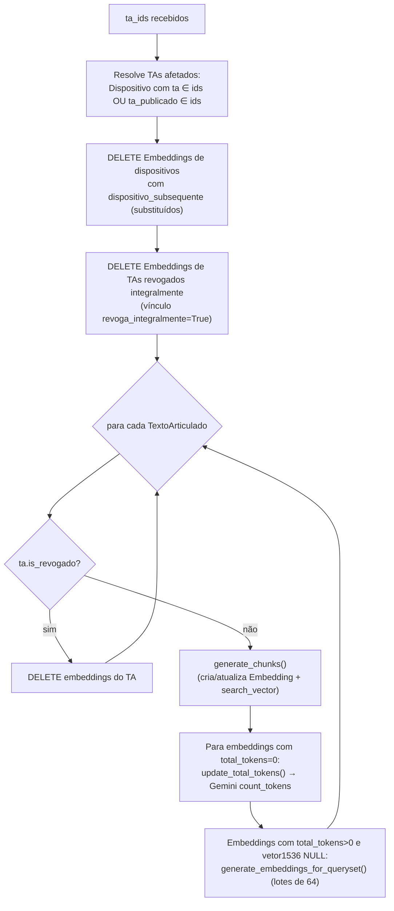
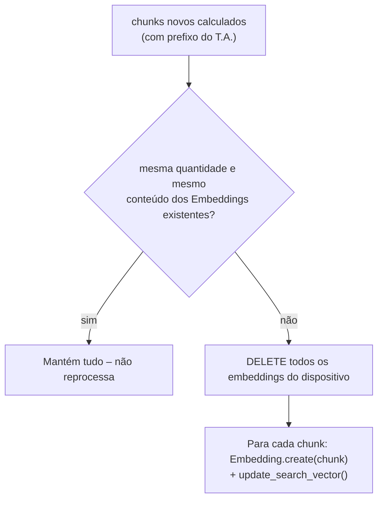

# 2. Ingestão e Indexação (pipeline offline)

Responsável por popular `search_embedding` com os trechos pesquisáveis das normas.

Arquivos envolvidos:

* Gatilho: [sapl/compilacao/views.py](../../sapl/compilacao/views.py) (publicação do T.A.)
* Orquestração: [cmj/search/tasks.py](../../cmj/search/tasks.py)
* Segmentação: `TextoArticulado.generate_chunks` em [sapl/compilacao/models.py](../../sapl/compilacao/models.py)
* Persistência/vetorização: `Embedding` em [cmj/search/models.py](../../cmj/search/models.py)
* API de embeddings: `IAGenaiBase.embed_documents` em [cmj/utils/genia/\_\_init\_\_.py](../../cmj/utils/genia/__init__.py)

## 2.1 Gatilho

Ao publicar um Texto Articulado (parâmetro `lock` na view de checagem/publicação), o T.A. é marcado
como `editing_locked=True` e público, e então:

| Ambiente | Execução |
|----------|----------|
| Produção (`not DEBUG`) ou DEBUG dentro do container oficial (`FOLDER_DEBUG_CONTAINER == PROJECT_DIR`) | `task_sync_embeddings_textoarticulado.apply_async(([ta_id],), countdown=5)` na fila Celery **`cq_base`** |
| DEBUG local | Chamada síncrona de `task_sync_embeddings_textoarticulado_function([ta_id])` |

A task captura qualquer exceção e apenas registra em log (`logger.error`) – falhas não interrompem a publicação.

## 2.2 Orquestração – `task_sync_embeddings_textoarticulado_function(ta_ids)`



Pontos importantes:

* O escopo considera tanto `ta` quanto `ta_publicado` – assim, um T.A. de **alteração** que modifica
  dispositivos de outra norma faz a norma alterada ser **reindexada**.
* Só entram no índice dispositivos **vigentes** (`dispositivo_subsequente IS NULL`). Quando um dispositivo
  é substituído por uma redação nova, seus embeddings antigos são apagados.
* Normas **revogadas integralmente** não ficam no índice (o chat não responde com lei revogada).
* O trecho após `continue` na função (prints de depuração) é **código morto**.

## 2.3 Segmentação – `TextoArticulado.generate_chunks()`

### Quais dispositivos geram chunks

Somente os tipos **individualizáveis**:

```python
["Ementa", "Artigo", "Parágrafo", "Inciso", "Alinea", "Item"]
```

Dispositivos de outros tipos (Capítulo, Seção, Título, Livro etc.) **não geram chunk próprio**, mas
aparecem como *ancestrais* no cabeçalho dos chunks de seus filhos. Dispositivos sem texto **e** sem
rótulo são ignorados.

### Composição do texto de cada chunk

Para um dispositivo `d` individualizável, o texto é `ancestrais + [d] + seguintes`:

| Parte | Como é obtida |
|-------|---------------|
| **Ancestrais** (`textos_previous`) | `d.get_parents()` – inseridos do mais alto ao mais próximo, cada um como `"<rótulo> <texto renderizado>"` |
| **O próprio dispositivo** | `rótulo + " " + render_texto()` |
| **Seguintes** (`textos_next`) | Os dispositivos subsequentes na ordem do T.A., enquanto `nivel > d.nivel` (descendentes). O primeiro dispositivo de nível **≤** ao de `d` (fronteira) **também é incluído**; se essa fronteira for um **Artigo**, inclui-se **mais um** dispositivo depois dele |

```text
Exemplo (Art. 5º com 2 incisos, seguido do Art. 6º):

  [ancestrais]   CAPÍTULO II - DOS INCENTIVOS
  [d]            Art. 5º  A prefeitura poderá conceder ...:
  [descendente]  I - asfaltamento ...
  [descendente]  II - terraplenagem ...
  [fronteira]    Art. 6º  ...
  [+1 extra]     (dispositivo seguinte ao Art. 6º, pois a fronteira é Artigo)
```

O objetivo é que a resposta nunca fique "cortada": o LLM vê o *caput*, os incisos/alíneas e o começo do
próximo artigo.

> Existe um bloco `if False:` (retorno linear) mantido como alternativa descartada.

### Divisão por tamanho (`chunk_size = 1536` **palavras**)

Os textos são acumulados em `current_chunk` separados por `" \n "`. Se adicionar o próximo texto ultrapassar
**1536 palavras** (contadas com `split()`, não tokens), fecha-se o chunk atual e inicia-se outro.

### Normalização

Para cada chunk:

1. `str(BeautifulSoup(c, "html.parser"))` – converte entidades (`&aacute;` → `á`);
2. `re.sub(r"[ \t]{2,}", " ")` – colapsa espaços/tabs;
3. `re.sub(r" \n \n ", " \n ")` – remove linhas vazias duplicadas;
4. remove espaços/quebras de linha iniciais.

### Formato final persistido

```text
<str(TextoArticulado)> \n <chunk normalizado>
```

A **primeira linha** é sempre a identificação do Texto Articulado (ex.: "Lei Ordinária 4.353/2020 …").
É ela que a recuperação transforma em `Fonte: <a href="/ta/<id>/text">…</a>`
(ver [03-recuperacao-hibrida.md](./03-recuperacao-hibrida.md)).

### Sincronização incremental com o banco

Para cada dispositivo com chunks:



Consequência: **vetores só são recalculados quando o texto muda**, economizando chamadas à API.
Novos embeddings nascem com `total_tokens=0` e `vetor1536=NULL`, o que os marca como pendentes para
as etapas seguintes da task.

O método retorna a lista `[(dispositivo, {"embeddings","rendered","texto","rotulo","chunks"}), ...]`,
que a task usa para filtrar os embeddings do T.A. corrente.

## 2.4 Vetorização e tokens (`Embedding`)

| Método | O que faz |
|--------|-----------|
| `update_search_vector()` | `UPDATE ... SET search_vector = to_tsvector('portuguese', chunk)` para a linha |
| `update_all_search_vectors()` (classmethod) | Mesmo `UPDATE` em lote para toda a tabela (útil em reindexação total) |
| `update_total_tokens()` | `IAGenaiBase.count_tokens_in_text(chunk)` (Gemini `count_tokens`, 0 em caso de erro) e `save()` |
| `generate_embedding()` | Vetoriza **um** chunk, salva em `vetor1536` |
| `generate_embeddings_for_queryset(qs)` | Vetoriza o queryset **em lote**; para cada item grava `vetor1536` e zera o campo legado `vetor` (3072) |

### `IAGenaiBase.embed_documents`

* Modelo: **`gemini-embedding-2`**, `output_dimensionality=1536`.
* Lotes de **64** documentos por chamada.
* Formatação de documento exigida pelo modelo: `"title: {titulo|none} | text: {texto}"`
  (`prepare_document`). Aqui o título é sempre `None` → `title: none | text: ...`.
* `task_type` **não** é enviado (a instrução vai no próprio texto).
* Em exceção, registra o erro e **devolve o que já foi gerado** (lotes anteriores). Como o laço para no
  primeiro erro, o resultado parcial continua alinhado com o início do queryset.

### Assimetria documento × consulta

| Lado | Formato do texto enviado ao modelo |
|------|------------------------------------|
| Documento | `title: none \| text: <chunk>` |
| Consulta | `task: question answering \| query: <consulta>` (`get_query_embedding`, `is_qa_mode=True`) |

Essa assimetria é intencional e recomendada para o `gemini-embedding-2`. Se o formato de documento
mudar, **todos os vetores precisam ser regenerados** para manter a comparabilidade.

## 2.5 Reindexação manual

Útil quando se altera o modelo de embedding, o formato do prefixo ou o algoritmo de chunking:

1. Ajustar o código (ex.: `chunk_size`, tipos individualizáveis).
2. Executar `task_sync_embeddings_textoarticulado_function([ids...])` (shell Django/notebook – ver
   `__notebooks_private/2026/compilacao__dispositivo__chunking.py` para experimentos).
3. Para forçar novos vetores: `Embedding.objects.update(vetor1536=None)` e reexecutar a task
   (os registros voltam a ser "pendentes").
4. Para recalcular o FTS em massa: `Embedding.update_all_search_vectors()`.
