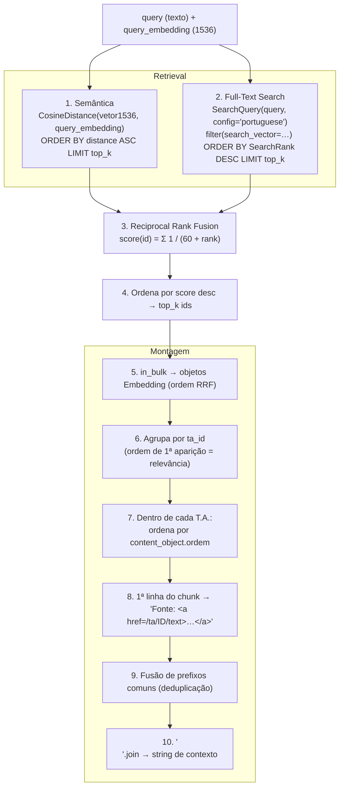

# 3. Recuperação Híbrida – `Embedding.make_context`

Implementação: `Embedding.make_context(search_query, query_embedding, top_k=60)` em
[cmj/search/models.py](../../cmj/search/models.py).

É a etapa de **Retrieval** do RAG. Recebe o texto da consulta e seu vetor (1536 dim) e devolve **uma
string** pronta para ser entregue ao LLM como resultado da *tool* `buscar_na_base_dados`.

## 3.1 Pipeline



## 3.2 Etapas em detalhe

### 1) Busca semântica
`CosineDistance("vetor1536", query_embedding)` (pgvector, operador `<=>`), ordenada de forma crescente
(0 = idêntico, 2 = oposto). Usa o índice **HNSW** `embedding_vetor1536_hnsw`
(`halfvec_cosine_ops`, `m=16`, `ef_construction=64`). Retorna só os **IDs** dos `top_k` (60) mais próximos.

### 2) Busca por palavra-chave (FTS)
`SearchQuery(search_query, config="portuguese")` – o `search_type` padrão do Django é **`plain`**
(`plainto_tsquery`): todos os termos são combinados com **AND** e passam por *stemming* em português.
Usa o índice GIN `embedding_search_vector_gin`. Ordena por `SearchRank` decrescente e limita a `top_k`.

> **Consequência prática:** quanto mais termos a *query* tiver, mais restritivo fica o FTS (todos precisam
> existir no chunk). Por isso a *system instruction* manda o LLM extrair **só as palavras-chave centrais**
> e tentar sinônimos/números isolados (ver [04](./04-chat-websocket-e-llm.md#46-system-instruction-v3)).
> Quando o FTS não retorna nada, a busca semântica ainda alimenta o resultado.

### 3) Reciprocal Rank Fusion (RRF)
```python
RRF_K = 60
for rank, id in enumerate(semantic_ids, 1): score[id] += 1 / (RRF_K + rank)
for rank, id in enumerate(text_ids, 1):     score[id] += 1 / (RRF_K + rank)
```
* Só usa **posição**, não os valores de distância/rank – não é preciso normalizar escalas diferentes.
* Um chunk presente nas duas listas soma as duas contribuições e tende a subir.
* O resultado (até 120 candidatos únicos) é cortado novamente em `top_k` = 60.

### 4–5) Hidratação
`Embedding.objects.in_bulk(sorted_ids)` carrega os objetos e a lista é remontada **preservando a ordem RRF**.
Cada `embed.content_object` (GenericForeignKey → `Dispositivo`) é acessado em seguida.

### 6–7) Agrupamento por Texto Articulado
* `tas` (`OrderedSet`) guarda os `ta_id` na ordem em que aparecem – o T.A. cujo chunk é mais relevante vem primeiro.
* Dentro de cada T.A., os chunks são ordenados por `content_object.ordem`, reconstruindo a sequência
  natural do texto legal.
* Objetos sem atributo `ta_id` (ex.: outros modelos que venham a ter embeddings) são **ignorados**.

### 8) Linha "Fonte"
Cada chunk é dividido em linhas (`chunk.split("\n")`, com `strip`). A **primeira linha** (identificação
do T.A.) é reescrita como:

```text

Fonte: <a href="/ta/793/text">Lei Ordinária 4.353 ...</a>
```

O LLM converte esse `<a>` em Markdown `[texto](/ta/793/text)`, mantendo a URL **relativa**.

### 9) Fusão de prefixos comuns (deduplicação)
Chunks do mesmo T.A. repetem as linhas iniciais (Fonte, ancestrais como Capítulo/Seção). O laço final faz
uma espécie de *merge* por prefixo:

```text
repita:
    item = None
    para cada lista de linhas, em ordem:
        se vazia → pula
        se item é None → item = lista.pop(0); continua
        se item == lista[0] → lista.pop(0) (descarta repetição); continua
        senão → interrompe a varredura
    se item é None → fim
    saída.append(item)
```

Efeito: sequências consecutivas de chunks com o mesmo cabeçalho/ancestrais saem com esse cabeçalho **uma só
vez**, seguido dos trechos específicos de cada um. Reduz tokens e melhora a legibilidade.

### 10) Saída
`"\n".join(context_list_of_str)` – texto plano com marcações `Fonte: <a …>` que é retornado ao Gemini
como resposta da função.

## 3.3 Parâmetros

| Parâmetro | Valor | Onde alterar |
|-----------|-------|--------------|
| `top_k` | 60 (semântica, FTS e corte final) | assinatura de `make_context` |
| `RRF_K` | 60 | constante local |
| Dimensão da consulta | 1536 | `IAGenaiBase.get_query_embedding` |
| Config FTS | `portuguese` | `make_context` e `update_search_vector` (devem ser a mesma) |
| Métrica | cosseno | `CosineDistance` + `halfvec_cosine_ops` |

## 3.4 Versões anteriores (mantidas no arquivo)

| Método | Estado | Observação |
|--------|--------|------------|
| `make_context__20260225(query_embedding, top_k=50)` | Legado | Apenas busca semântica; mesma montagem por T.A./`ordem` e fusão de prefixos |
| `make_context__old(query_embedding, top_k=50)` | Legado, **com falha documentada** | Usava o texto da primeira linha como chave; dispositivos com mesmo texto e pais diferentes colidiam e se perdiam, além de perder a ordem de similaridade |

Nenhum dos dois é chamado pelo `ChatManager`.

## 3.5 Exemplo ilustrativo de retorno

```text

Fonte: <a href="/ta/793/text">Lei Ordinária 4.353/2020</a>
CAPÍTULO II - DOS INCENTIVOS
Art. 5º A prefeitura poderá conceder incentivos ...:
I - asfaltamento de pátios ...
II - serviços de terraplenagem ...

Fonte: <a href="/ta/1021/text">Decreto 120/2021</a>
Art. 2º Regulamenta o art. 5º da Lei 4.353/2020 ...
```
