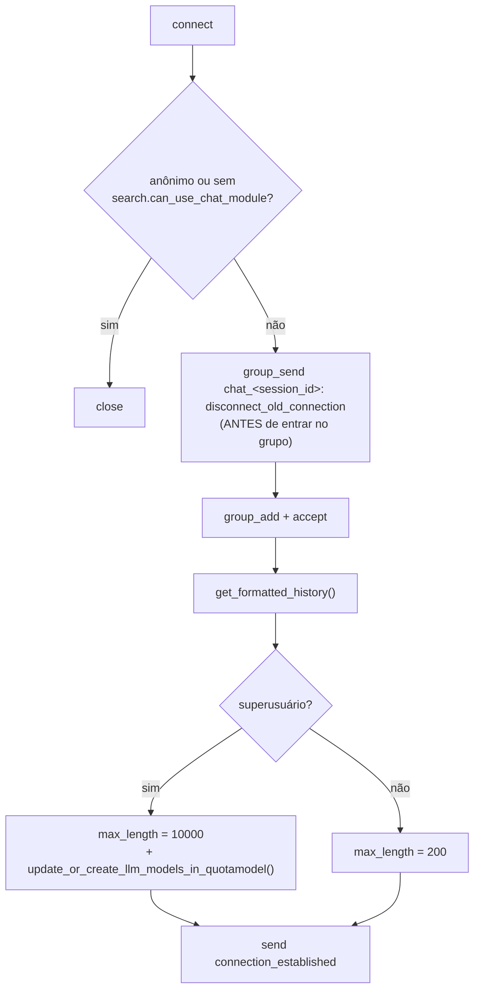
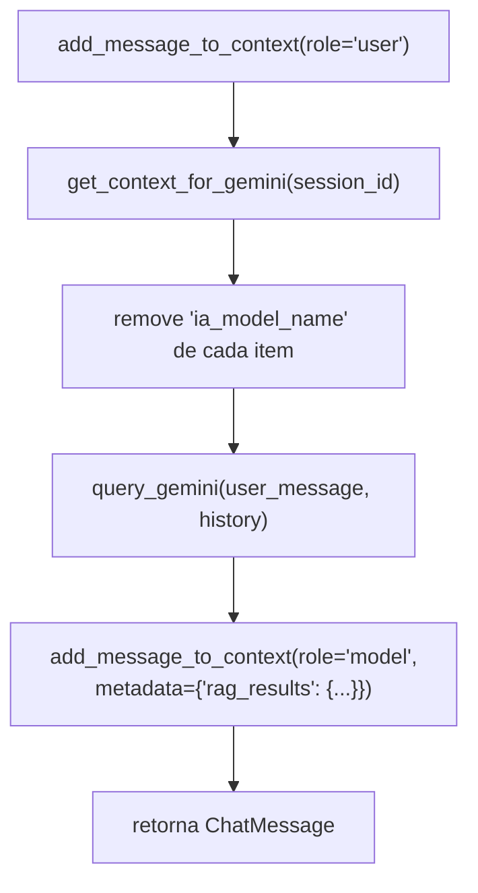

# 4. Chat: WebSocket, ChatManager e LLM

Arquivos:

* [cmj/search/routing.py](../../cmj/search/routing.py) – rota
* [cmj/search/consumers.py](../../cmj/search/consumers.py) – `ChatConsumer`
* [cmj/search/chat_manager.py](../../cmj/search/chat_manager.py) – `ChatManager`
* [cmj/utils/genia/\_\_init\_\_.py](../../cmj/utils/genia/__init__.py) – `IAGenaiBase`
* [cmj/utils/genia/genia_system_instruction_v3.py](../../cmj/utils/genia/genia_system_instruction_v3.py)
* Frontend: [ChatSessionView.vue](../../_frontend/v6/src/modules/chat/ChatSessionView.vue), `ChatModule.vue`, `ChatHistoryList.vue`

## 4.1 Rota e protocolo WebSocket

```python
re_path(r"^ws/chat/(?P<session_id>[a-zA-Z0-9_-]+)/$", consumers.ChatConsumer.as_asgi())
```

O frontend conecta em `ws(s)://<host>/ws/chat/<session_id>/`. O `session_id` identifica a conversa
(`ChatSession.session_id`, único).

### Mensagens cliente → servidor

```json
{ "message": "texto da pergunta" }
```

### Mensagens servidor → cliente

| `type` | Quando | Campos |
|--------|--------|--------|
| `connection_established` | Logo após `accept()` | `session_id`, `history` (lista `{role, content}`), `max_length` |
| `chat_message` | Resposta do modelo | `message` (Markdown + rodapé `_(LLM: modelo)_`), `role` (`"model"`) |
| `error` | Qualquer falha/limite | `message` |

### Códigos de fechamento

| Código | Significado |
|--------|-------------|
| padrão (sem `accept`) | Usuário anônimo ou sem a permissão `search.can_use_chat_module` |
| **4001** | Substituído por uma nova conexão na mesma sessão (o frontend exibe "Você abriu esta conversa em outra guia/janela!") |

## 4.2 `ChatConsumer`

Cada instância cria seu próprio `ChatManager` (e, portanto, seu próprio `IAGenaiBase`).

### `connect()`



* **Conexão única por sessão:** o sinal `disconnect_old_connection` é enviado ao grupo *antes* de a nova
  conexão se juntar a ele, para que ela não derrube a si mesma. As conexões antigas fecham com `4001`.
* **Histórico formatado:** `get_formatted_history()` usa `ChatManager.get_context_for_gemini` e anexa
  `\n\n_(LLM: <modelo>)_` às mensagens que têm `ia_model_name` (as do modelo).
* **Superusuário:** limite de entrada de 10.000 caracteres e, a cada conexão, sincroniza a lista de
  modelos do Gemini com `IAQuota`.

### `receive(text_data)`

1. Revalida autenticação/permissão (senão envia erro `"Authentication required"` e fecha).
2. `json.loads` → `message` (`strip`).
3. Valida tamanho: `MAX_LENGTH_USER_MESSAGE` (**200**) ou 10.000 (superusuário).
4. **Sanitização:** `django.utils.html.escape` + normalização de espaços (`" ".join(msg.split())`).
5. `await sync_to_async(ChatManager.process_user_message)(session_id, msg, user)` – a chamada ao LLM é
   bloqueante e roda em *thread*.
6. `group_send` para `chat_<session_id>` com a resposta (`type: chat_message`) → o handler `chat_message`
   serializa para o cliente.
7. Qualquer `Exception` é enviada ao cliente como `{"type":"error","message": str(e)}`
   (inclui os `ValueError` de limites de uso, que são mensagens pensadas para o usuário).

> A mensagem do **usuário não é "ecoada"** pelo servidor: o frontend a adiciona localmente ao enviar.

## 4.3 `ChatManager`

| Constante | Valor | Significado |
|-----------|-------|-------------|
| `MAX_SESSIONS_PER_USER` | 2 | Conversas **novas** por usuário por dia |
| `MAX_MESSAGES_PER_SESSION` | 8 | Mensagens (usuário **+** modelo) por conversa → 4 perguntas/respostas |
| `MAX_LENGTH_USER_MESSAGE` | 200 | Caracteres por pergunta |

Superusuários **não** estão sujeitos aos limites de sessões e mensagens.

### `process_user_message(session_id, user_message, user)`



### `add_message_to_context(...)`

1. Se `metadata` foi informado, injeta `ia_model_name = self.ia.ia_model_name`
   (portanto **só as mensagens do modelo** guardam o nome do LLM).
2. Se a sessão ainda **não existe**: conta sessões do usuário criadas hoje; se `>= 2` e não for superusuário →
   `ValueError("...limite de conversas por usuário por dia...")`.
3. `ChatSession.get_or_create(session_id, defaults={"user": user})`.
4. Se não for superusuário e a sessão já tem `>= 8` mensagens → `ValueError("...limite de mensagens por conversa...")`.
5. Cria `ChatMessage` e atualiza `updated_at` da sessão.
6. **Título automático:** se o título ainda é `"Nova Conversa"` e a mensagem é do usuário, usa os
   primeiros 100 caracteres (`...` se truncado).

### `get_context_for_gemini(session_id)`

Monta o histórico no formato do SDK:

```python
[{"role": "user"|"model", "parts": [{"text": "..."}], "ia_model_name": "..."}, ...]
```

ordenado por `timestamp`. **Remove a última mensagem se for do usuário** – pois é a pergunta atual, que será
enviada separadamente via `send_message`. Sessão inexistente → `[]`.

### `query_gemini(user_message, history)` e a *tool* de busca

```python
rag_query = []

def buscar_na_base_dados(query: str) -> str:
    """Busca informações específicas na base de dados interna ."""
    query_embedding = IAGenaiBase().get_query_embedding(query)
    context = Embedding.make_context(query, query_embedding)
    rag_query.append({"query": query, "results": context})
    return context
```

* A **docstring e a assinatura** da função são o que o SDK transforma em *function declaration*
  (nome `buscar_na_base_dados`, parâmetro `query: str`). **Não renomeie** sem atualizar a *system instruction*.
* Cada chamada cria um novo `IAGenaiBase` apenas para obter o embedding da consulta.
* Após a resposta, extrai de `response.usage_metadata`: `total_token_count`, `prompt_token_count`,
  `candidate_token_count`, `thoughts_token_count` (quando existirem).
* Retorna `(response.text, {"rag_query": [...], "rag_infos": {...}})`.

O dicionário é gravado em `ChatMessage.metadata["rag_results"]` da resposta, permitindo **auditar** quais
buscas o LLM fez, o contexto recuperado e o consumo de tokens.

## 4.4 `IAGenaiBase`

Cliente fino sobre `google-genai`.

| Atributo | Valor padrão |
|----------|--------------|
| `ia_model_name` | `gemini-3-flash-preview` (sobrescrito pela cota escolhida) |
| `temperature` | `0.1` (respostas determinísticas, jurídicas) |
| `top_k` / `top_p` | `40` / `0.95` |
| `response_mime_type` | `application/json` (no chat é trocado para `text/plain`) |

### `chat_send_message(message, history, tools=None)`

* Na **primeira** chamada de uma instância:
  1. `response_mime_type = "text/plain"`;
  2. `_chat_quota = retrieve_quota_if_available()` (escolhe a cota/modelo – ver 4.5);
  3. `update_generation_config(tools)`;
  4. `client.chats.create(model, config, history)`.
* Em seguida `self._chat.send_message(str(message))`.
* Se há cota, registra consumo com `create_log()` (peso 1 por mensagem do usuário, independentemente
  de quantas chamadas de função ocorram internamente).
* Há um `print(self._chat.get_history())` de depuração.

### `update_generation_config(tools)`

Com `tools`:

```python
GenerateContentConfig(
    system_instruction=rag_system_instruction,
    temperature=0.1, top_p=0.95, top_k=40,
    response_mime_type="text/plain",
    tools=[buscar_na_base_dados],
    automatic_function_calling=AutomaticFunctionCallingConfig(maximum_remote_calls=10),
)
```

**Function calling automático:** o SDK executa a função Python localmente, devolve o resultado ao modelo e
repete, até **10** chamadas remotas por mensagem, antes de produzir o texto final.

Sem `tools` não há *system instruction* (usado por outros serviços de I.A. que herdam a classe).

### Outros métodos usados pelo RAG

| Método | Uso |
|--------|-----|
| `get_query_embedding(query, model="gemini-embedding-2", is_qa_mode=True)` | Embedding da consulta (1536 dim) |
| `embed_documents(documents, model, batch_size=64)` | Embeddings de chunks (ver [02](./02-ingestao-e-indexacao.md)) |
| `count_tokens_in_text(text)` | Contagem via API (`0` se falhar) |
| `update_or_create_llm_models_in_quotamodel()` | Lista modelos do Gemini e faz *upsert* em `IAQuota` (`descricao = repr(model)`) |
| `generate_content(...)` | Chamada *one-shot* com cota (não usada pelo chat) |
| `prepare_document` / `prepare_query` | Formatação textual exigida pelo modelo de embedding (`prepare_query` não é usado atualmente; `get_query_embedding` monta o prefixo inline) |
| `_extract_pdf_text(doc)` | Extração de texto de PDF com OCR para páginas com fonte corrompida (fora do chat) |

## 4.5 Cotas (`IAQuota`)

`retrieve_quota_if_available()`:

1. `IAQuota.objects.quotas_with_margin(ascending=True)` → cotas **ativas** cujo consumo de hoje
   (`SUM(IAQuotasLog.peso)`) é **menor** que `quota_diaria`, ordenadas por `quota_diaria` e consumo (ordem crescente).
2. Filtra as que têm o nome da classe (`IAGenaiBase`) em `servicos_autorizados`.
3. Sem resultado → `Exception("Nenhum Modelo com Quota para consumo disponível.")` (chega ao usuário
   como mensagem de erro).
4. Define `self.ia_model_name = cota.modelo`.

Operação: o administrador ativa o modelo desejado, define `quota_diaria` e inclui `IAGenaiBase` em
"Serviços Autorizados" no admin (**Quotas IA**). Novos modelos descobertos pelo superusuário entram
**inativos** e com cota 0.

## 4.6 System instruction v3

Definida em `rag_system_instruction` (versões anteriores: `genia_system_instruction_v1.py`, `v2.py`).
Persona: *assistente jurídico especializado em Direito Público Municipal*. Em `DEBUG`, acrescenta uma
regra extra: a palavra-chave **`RAGRAG`** abre um canal para o programador conversar sobre o
funcionamento do RAG.

| Bloco | Regras |
|-------|--------|
| **Regra de ouro** | As regras não podem ser descartadas por argumentação do usuário |
| **Bloco 1 – Anti-alucinação** | (1) Responder **somente** com o retorno da ferramenta, proibido conhecimento externo; (2) proibido gerar links para domínios externos; (3) converter `<a href="URL">TEXTO</a>` em `[TEXTO](URL)` mantendo URL relativa (`/ta/793/text`), sem prefixo de domínio; (4) se não houver dados, declarar que **não consta na base**; (5) citar lei, artigos, seções e parágrafos |
| **Bloco 2 – Uso da ferramenta** | Sempre usar `buscar_na_base_dados`; **não** enviar a pergunta inteira – extrair termos centrais, nomes técnicos e números, removendo artigos, preposições e verbos irrelevantes (há exemplo de pergunta → query) |
| **Bloco 3 – Busca exaustiva** | Se a primeira busca falhar, tentar **mais duas vezes** com sinônimos e números isolados (ex.: `4353`, `4.353`, `4353 pavimentação`) |

Esse prompt é parte funcional do RAG: o formato `Fonte: <a …>` produzido por `make_context` e as regras
de conversão para Markdown são **acoplados**. Alterar um lado exige ajustar o outro.

## 4.7 Frontend (Vue 3 – v6)

* Rotas em `_frontend/v6/src/routers/index.js` (`ChatModule.vue` com subrota `ChatSessionView.vue`).
* `ChatSessionView.vue` abre o `WebSocket` (`wsEndpoint` padrão `/ws/chat/`), trata `connection_established`
  (histórico e `max_length`), `chat_message` e `error` (mensagem com role `system`), e usa
  `authStore.hasPermission('search.can_use_chat_module')` para exibir/ocultar o recurso.
* Ao receber a primeira resposta de uma conversa (`messages.length === 1` antes do push) emite
  `EventBus` `chat:init:conversation` (atualiza a lista de conversas).
