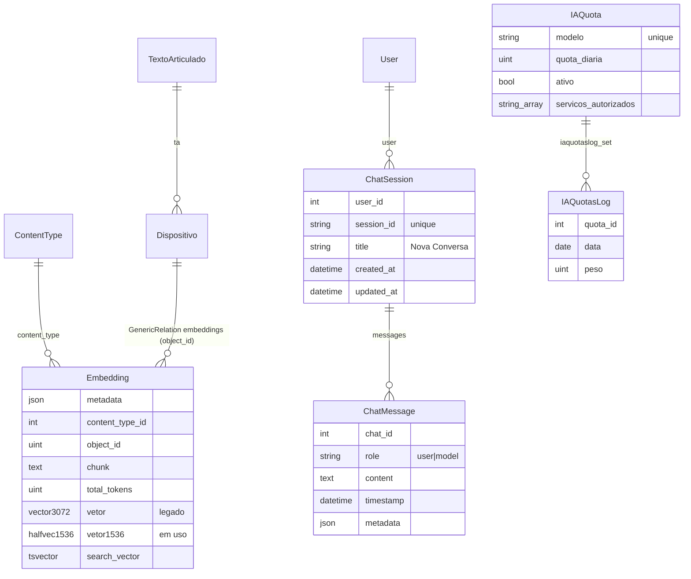

# 5. Modelos de Dados

Todos em [cmj/search/models.py](../../cmj/search/models.py), exceto `IAQuota`/`IAQuotasLog`
([cmj/core/models.py](../../cmj/core/models.py)).

## 5.1 Diagrama ER



## 5.2 `Embedding`

Herda de `CmjModelMixin`. Armazena **um chunk de texto + seus índices de busca**.

| Campo | Tipo | Descrição |
|-------|------|-----------|
| `metadata` | JSON (`DjangoJSONEncoder`) | Extensível; hoje não é preenchido pelo pipeline |
| `content_type` + `object_id` → `content_object` | GenericForeignKey | Objeto de origem (hoje, `Dispositivo`). `Dispositivo.embeddings` é uma `GenericRelation` com `related_query_name="dispositivo_set"` (permite `Embedding.objects.filter(dispositivo_set__ta=…)`) |
| `chunk` | Text | Texto que foi vetorizado: `"<str(T.A.)> \n <trecho>"` |
| `total_tokens` | PositiveInteger | Tokens do chunk (Gemini `count_tokens`); `0` = ainda não contado |
| `vetor` | `VectorField(3072)` | **Legado** (modelo anterior). É zerado (`None`) quando o vetor novo é gerado |
| `vetor1536` | `HalfVectorField(1536)` | Vetor **em uso** pela busca semântica |
| `search_vector` | `SearchVectorField` | `tsvector` em `portuguese` sobre `chunk` |

Índices (`Meta.indexes`):

| Nome | Tipo | Campo | Uso |
|------|------|-------|-----|
| (automático) | B-tree composto | `content_type`, `object_id` | Buscar/limpar embeddings de um objeto |
| `embedding_vetor1536_hnsw` | HNSW (`halfvec_cosine_ops`, m=16, ef_construction=64) | `vetor1536` | Busca vetorial aproximada por cosseno |
| `embedding_search_vector_gin` | GIN | `search_vector` | FTS |

`Meta.ordering = ("-id",)`.

### Estados de um embedding (ciclo de vida)

| Estado | `total_tokens` | `vetor1536` | `search_vector` | Quem o produz |
|--------|----------------|-------------|-----------------|---------------|
| Criado | 0 | NULL | preenchido (`update_search_vector`) | `generate_chunks` |
| Contado | > 0 | NULL | preenchido | `update_total_tokens` |
| **Indexado (pronto)** | > 0 | preenchido | preenchido | `generate_embeddings_for_queryset` |
| Removido | – | – | – | dispositivo substituído / T.A. revogado |

> A busca semântica ignora (por distância indefinida) registros sem `vetor1536`; a FTS os encontra
> assim que o `search_vector` existir.

### Métodos

Ver [02 §2.4](./02-ingestao-e-indexacao.md#24-vetorização-e-tokens-embedding) e
[03](./03-recuperacao-hibrida.md). `__str__` retorna id, objeto, `ta_id` e tokens.

## 5.3 `ChatSession`

| Campo | Descrição |
|-------|-----------|
| `user` | FK para o usuário (`CASCADE`) |
| `session_id` | `CharField(255)`, **único** e indexado – é o valor da URL do WebSocket |
| `title` | Padrão `"Nova Conversa"`; vira os primeiros 100 caracteres da primeira pergunta |
| `created_at` / `updated_at` | Usados na contagem diária de sessões e na ordenação (`-updated_at`) |

* Índice `(user, -updated_at)`.
* **Permissão customizada:** `search.can_use_chat_module` ("Usuário pode usar o módulo de chat").
  Mapeada em [cmj/globalrules/map_rules.py](../../cmj/globalrules/map_rules.py) para `ChatSession` e `ChatMessage`.

## 5.4 `ChatMessage`

| Campo | Descrição |
|-------|-----------|
| `chat` | FK para `ChatSession` (`related_name="messages"`, `CASCADE`) |
| `role` | `user` ou `model` (nomenclatura do Gemini) |
| `content` | Texto. Para `user`, já **escapado** (`html.escape`); para `model`, Markdown |
| `timestamp` | `auto_now_add`; define a ordem do histórico |
| `metadata` | JSON – ver abaixo |

Índice `(chat, timestamp)`.

### Estrutura de `metadata` (mensagens do modelo)

```json
{
  "ia_model_name": "gemini-3-flash-preview",
  "rag_results": {
    "rag_query": [
      { "query": "asfaltar pátios terraplenagem incentivo", "results": "\nFonte: <a href=\"/ta/793/text\">…</a>\n…" }
    ],
    "rag_infos": {
      "total_token_count": 18231,
      "prompt_token_count": 17102,
      "candidate_token_count": 412,
      "thoughts_token_count": 717
    }
  }
}
```

Mensagens do usuário têm `metadata = {}`.

## 5.5 `IAQuota` e `IAQuotasLog`

| Modelo | Campos-chave | Função |
|--------|--------------|--------|
| `IAQuota` | `modelo` (único), `quota_diaria`, `ativo`, `servicos_autorizados` (array), `batch_size`, `get_threads`, `descricao` | Define quais modelos podem ser usados, por quais serviços e o teto diário |
| `IAQuotasLog` | `quota`, `data`, `peso`, `timestamp` | Uma linha por uso (`create_log(peso=1)`) |

`IAQuota.objects.quotas_with_margin()`, `has_margin()` e `remaining_quota()` calculam o saldo do dia
(`quota_diaria − Σ peso` na data local). Serviços autorizados disponíveis: `IAGenaiBase`,
`IAClassificacaoMateriaService`, `IAAnaliseSimilaridadeService`.
